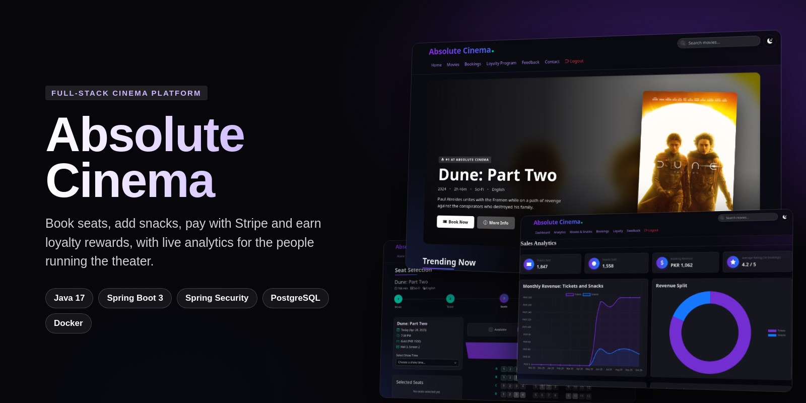
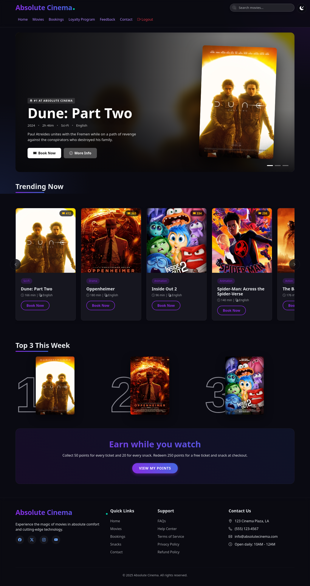
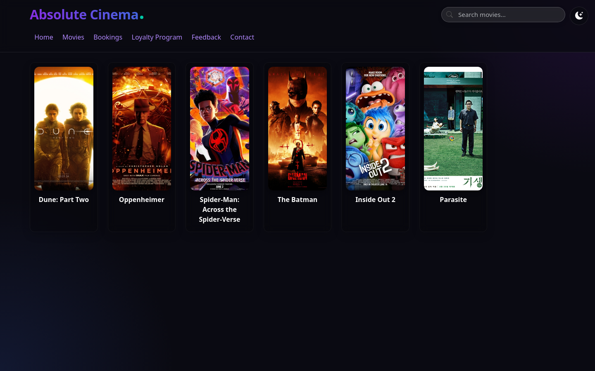
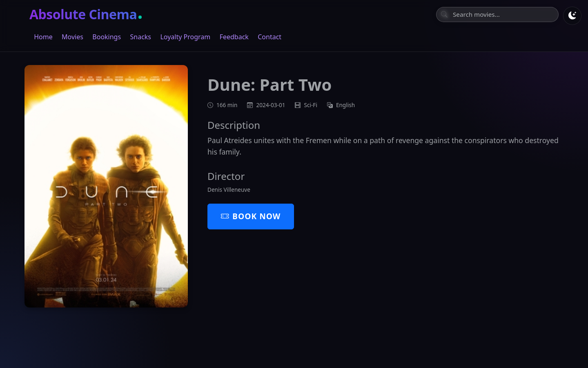
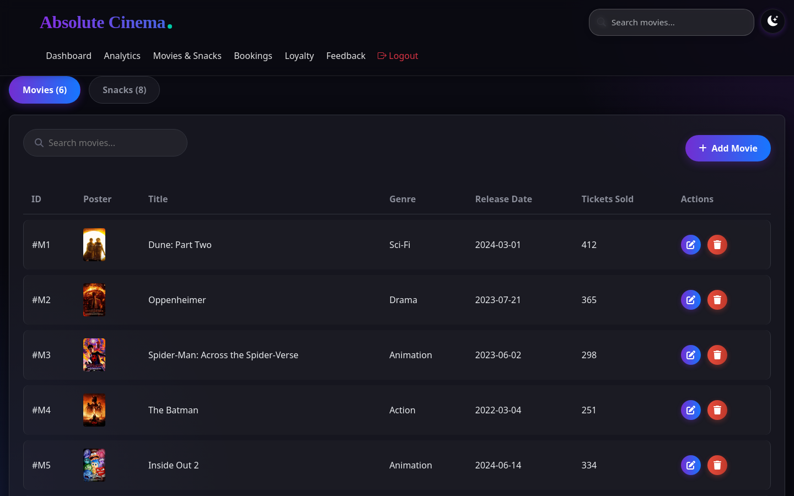
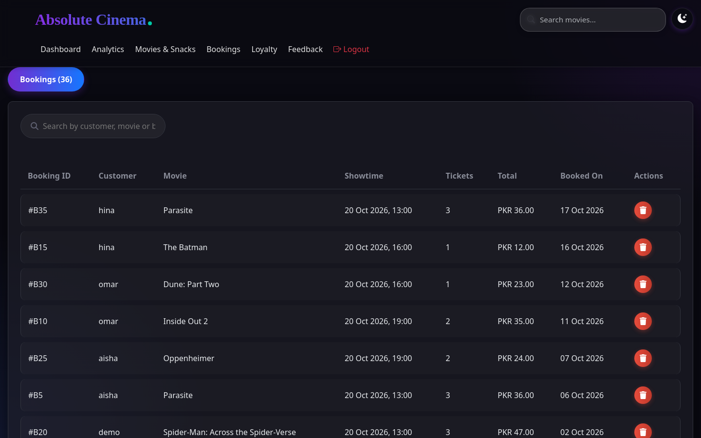
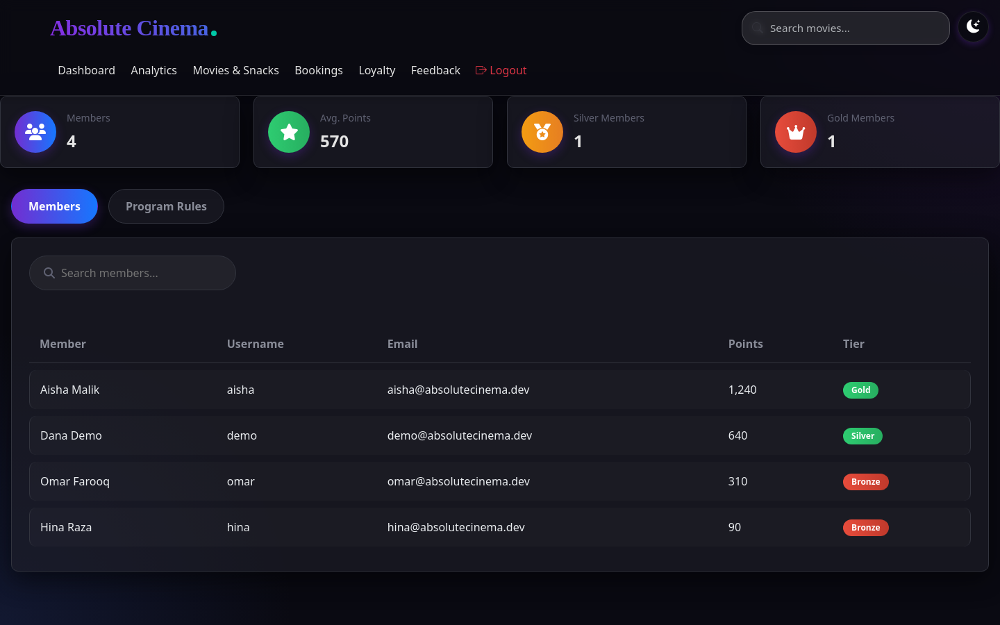
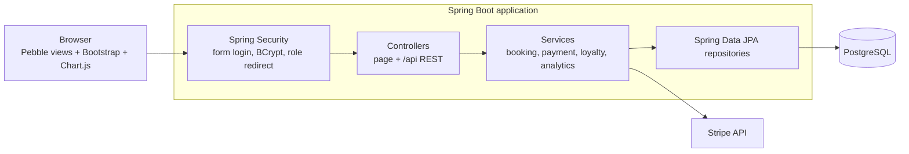

<div align="center">

**A full-stack cinema management platform: ticket booking, seat selection, snacks, Stripe payments, loyalty rewards, and admin analytics.**

[](https://github.com/AnnusShahzad/AbsoluteCinema/actions/workflows/ci.yml)


[](LICENSE)



</div>

## Overview

Absolute Cinema is a Spring Boot web application that runs a movie theater end to end. Customers browse the catalog, pick a showtime and seats, add snacks, and pay with Stripe, earning loyalty points along the way. Staff see their shifts and salary, and administrators get dashboards for sales, popular movies, and customer feedback.

It was built by a team of six, using GitHub issues for planning and pull requests for review.

## Features

| Area | What it does |
| --- | --- |
| **Authentication & roles** | Spring Security form login with BCrypt. Accounts map to `ROLE_USER`, `ROLE_EMPLOYEE` or `ROLE_ADMIN`; admin pages, staff pages and catalog writes are restricted per role, and every state-changing request is CSRF-protected. |
| **Streaming-style home** | Featured hero, "Trending Now" poster row and a Top 3 ranking, all driven by live ticket sales. |
| **Booking flow** | Movie → showtime → interactive seat map → snacks → Stripe payment. Successful payments record the booking, update stock and sales counters, and award loyalty points. |
| **Loyalty program** | 50 points per ticket, 20 per snack, Bronze/Silver/Gold tiers, and 250 points redeemable for a free ticket and snack. |
| **Admin console** | Dashboard, sales analytics (monthly ticket vs. snack revenue, genre breakdown, best sellers), movie and snack management with add/edit/delete, booking cancellation, loyalty members, and customer feedback trends. |
| **Employee portal** | This month's shifts and salary for the signed-in staff member. |
| **REST API** | JSON endpoints under `/api/{movies,sessions,snacks,feedback}` power the dynamic UI. |

## Screenshots



| Movie catalog | Movie details |
| --- | --- |
|  |  |
| **Seat selection** | **Snacks** |
|  |  |
| **Sales analytics** | **Admin dashboard** |
|  |  |
| **Movie & snack management** | **Booking management** |
|  |  |
| **Loyalty members** | **Feedback analytics** |
|  |  |
| **Sign in** | **Employee portal** |
|  |  |

## Tech stack

- **Backend:** Java 17, Spring Boot 3.4 (Web MVC, Data JPA, Security), Hibernate
- **Database:** PostgreSQL
- **Views:** Pebble templates, Bootstrap 5, Chart.js, vanilla JavaScript
- **Payments:** Stripe Java SDK and Stripe.js
- **Testing:** JUnit 5, Mockito, AssertJ, Spring Security Test (MockMvc)
- **Build & tooling:** Gradle (Kotlin DSL), Docker, Docker Compose, GitHub Actions

## Architecture



The code follows a standard layered layout:

```
src/main/java/com/absolutecinema/
├── config/        # Security, persistence, and MVC configuration
├── controller/    # Page controllers and /api REST controllers
├── service/       # Business logic (bookings, payments, loyalty, analytics, payroll)
├── repository/    # Spring Data JPA repositories
└── entity/        # JPA entities: Movie, Session, Booking, Snack, User, Employee, Shift, Salary...
src/main/resources/
├── templates/     # Pebble views per area (auth, user, admin, employee, movies...)
└── static/        # CSS and JavaScript
```

## Getting started

### Option 1: Docker (recommended)

Requires Docker only.

```bash
git clone https://github.com/AnnusShahzad/AbsoluteCinema.git
cd AbsoluteCinema
docker compose up --build
```

When the app has started, load the demo data (movies, showtimes, snacks, and demo accounts):

```bash
docker compose exec -T db psql -U cinema -d absolutecinema < scripts/demo-data.sql
```

Open <http://localhost:8080> and sign in with one of these accounts (password `demo1234` for all):

| Username | Role |
| --- | --- |
| `demo` | Customer |
| `employee` | Employee |
| `admin` | Administrator |

To try card payments, export your [Stripe test keys](https://dashboard.stripe.com/test/apikeys) as `STRIPE_PUBLIC_KEY` and `STRIPE_SECRET_KEY` before running `docker compose up`.

### Option 2: Run locally

Requires JDK 17+ and a PostgreSQL instance.

```bash
cp .env.example .env      # then edit the database URL, credentials, and Stripe keys
./gradlew bootRun
```

## Testing

```bash
./gradlew test
```

Unit tests cover the analytics calculations (revenue split, monthly buckets, rankings), loyalty tiers and points, booking cancellation and snack updates. Web-layer tests check the security rules: anonymous users are sent to sign in, customers cannot reach admin pages or change the catalog, and requests without a CSRF token are rejected. CI runs the tests and builds the Docker image on every push.

## Team

Built collaboratively by
[@AnnusShahzad](https://github.com/AnnusShahzad),
[@Moeez-Salman](https://github.com/Moeez-Salman),
[@isbaharif](https://github.com/isbaharif),
[@Ryyan-Choudhary](https://github.com/Ryyan-Choudhary),
[@razaalirizvi4](https://github.com/razaalirizvi4) and
[@MMustafa1](https://github.com/MMustafa1).

## License

Released under the [MIT License](LICENSE).
