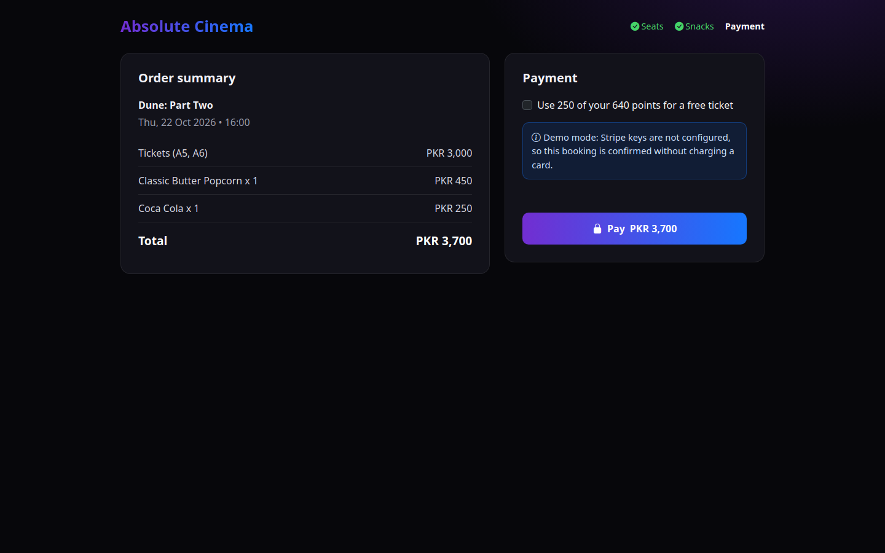
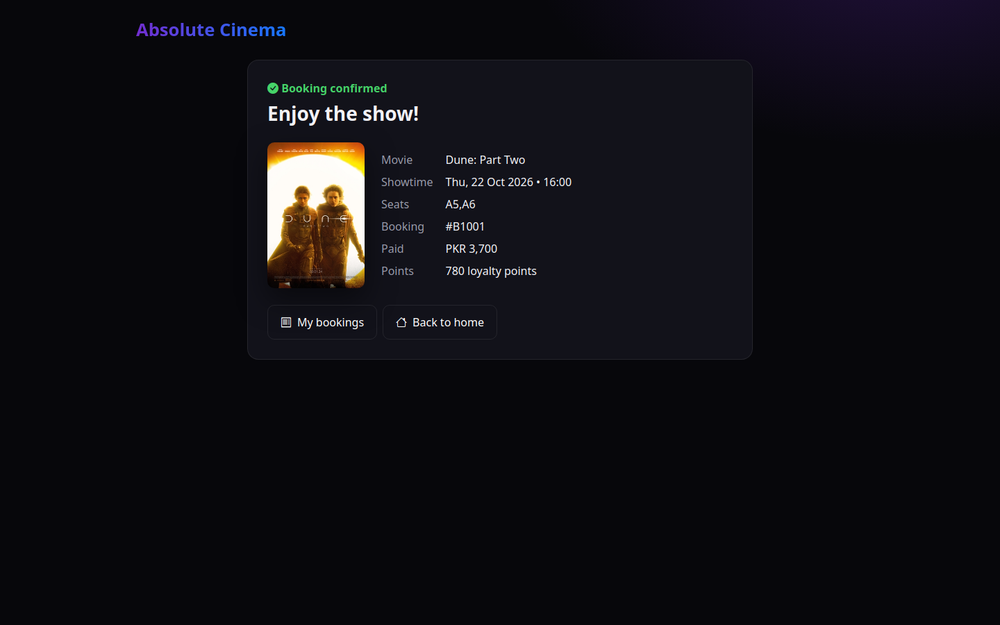
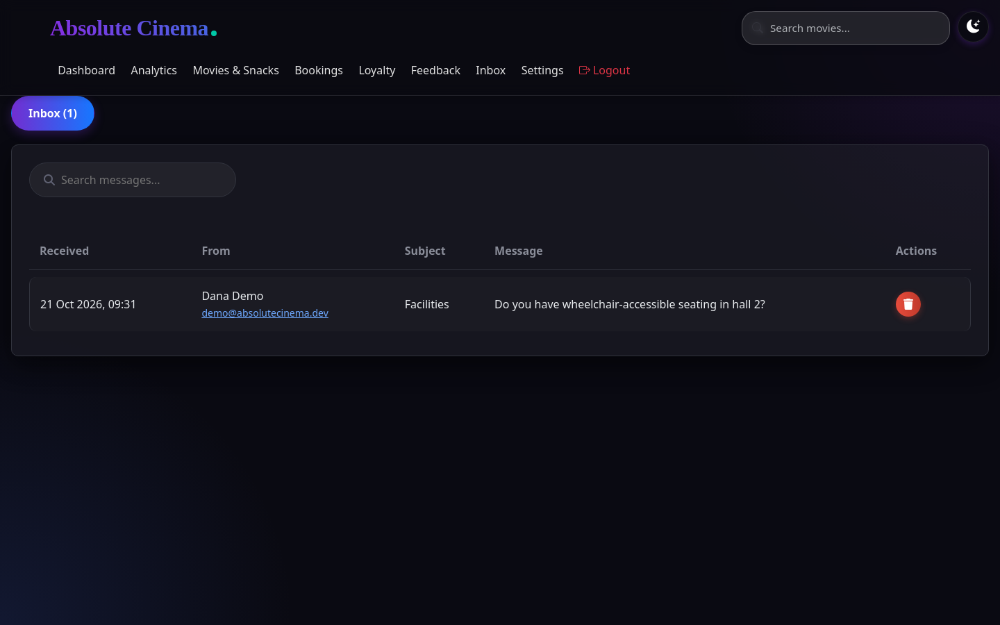
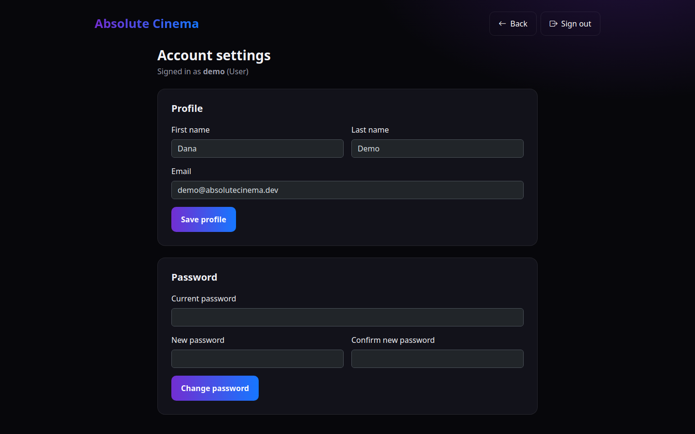
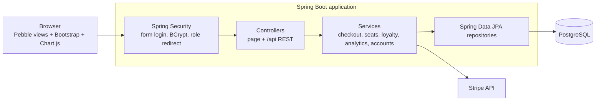

<div align="center">

**A full-stack cinema management platform: ticket booking, seat selection, snacks, Stripe payments, loyalty rewards, and admin analytics.**

[](https://github.com/AnnusShahzad/AbsoluteCinema/actions/workflows/ci.yml)
[](https://github.com/AnnusShahzad/AbsoluteCinema/actions/workflows/codeql.yml)
[](https://github.com/AnnusShahzad/AbsoluteCinema/releases/latest)


[](LICENSE)
[](CONTRIBUTING.md)


[Quick start](#getting-started) · [Screenshots](#screenshots) · [Architecture](#architecture) · [Contributing](CONTRIBUTING.md) · [Changelog](CHANGELOG.md)

</div>

## Overview

Absolute Cinema is a Spring Boot web application that runs a movie theater end to end. Customers browse the catalog, pick a showtime and seats, add snacks, and pay with Stripe, earning loyalty points along the way. Staff see their shifts and salary, and administrators get dashboards for sales, popular movies, and customer feedback.

It was built by a team of six, using GitHub issues for planning and pull requests for review.

## Features

| Area | What it does |
| --- | --- |
| **Booking flow** | Movie → showtime → interactive seat map → snacks → checkout → confirmation. Prices, seat availability and snack stock are decided on the server, and a seat can only be sold once per showtime, even under concurrent checkouts. |
| **Payments** | Stripe card payments. Without Stripe keys the app runs in demo mode and confirms bookings without charging, so the whole flow can be tried locally. |
| **Loyalty program** | 50 points per ticket, 20 per snack, Bronze/Silver/Gold tiers, and 250 points redeemable for a free ticket at checkout. |
| **Streaming-style home** | Featured hero, "Trending Now" poster row and a Top 3 ranking driven by live ticket sales, plus title and genre search. |
| **Accounts** | Registration with validation, role-based home pages, self-service password reset with 6-digit codes, and profile/password settings for every role. |
| **Admin console** | Dashboard, sales analytics (monthly ticket vs. snack revenue, genre breakdown, best sellers), movie and snack management, booking management with seats, loyalty members, feedback trends and a contact inbox. |
| **Employee portal** | This month's shifts and salary for the signed-in staff member. |
| **Security** | Spring Security with BCrypt, `ROLE_USER` / `ROLE_EMPLOYEE` / `ROLE_ADMIN` route rules, CSRF protection on every state-changing request, and no password hashes in API responses. |

## Screenshots


**Booking flow**

| Seat selection | Snacks |
| --- | --- |
|  |  |
| **Checkout** | **Confirmation** |
|  |  |
| **Movie catalog** | **Movie details** |
|  |  |

**Admin console and staff**

| Sales analytics | Admin dashboard |
| --- | --- |
|  |  |
| **Movie & snack management** | **Booking management** |
|  |  |
| **Loyalty members** | **Feedback analytics** |
|  |  |
| **Contact inbox** | **Employee portal** |
|  |  |
| **Sign in** | **Account settings** |
|  |  |

## Tech stack

- **Backend:** Java 17, Spring Boot 3.4 (Web MVC, Data JPA, Security), Hibernate
- **Database:** PostgreSQL
- **Views:** Pebble templates, Bootstrap 5, Chart.js, vanilla JavaScript
- **Payments:** Stripe Java SDK and Stripe.js
- **Testing:** JUnit 5, Mockito, AssertJ, Spring Security Test (MockMvc)
- **Build & tooling:** Gradle (Kotlin DSL), Docker, Docker Compose, GitHub Actions

## Architecture



The code follows a standard layered layout:

```
src/main/java/com/absolutecinema/
├── config/        # Security rules and error handling
├── controller/    # Page controllers and /api REST controllers (kept thin)
├── service/       # Business rules: checkout & pricing, seat layout, loyalty, analytics, accounts, password reset
├── repository/    # Spring Data JPA repositories
└── entity/        # JPA entities: Movie, Session, Booking, Snack, User, Employee, Shift, ContactMessage...
src/main/resources/
├── templates/     # Pebble views per area (auth, user, admin, employee, movies, account...)
└── static/        # CSS, JavaScript and images
scripts/demo-data.sql   # Demo movies, showtimes, bookings and accounts
```

## Getting started

### Option 1: Docker (recommended)

Requires Docker only.

```bash
git clone https://github.com/AnnusShahzad/AbsoluteCinema.git
cd AbsoluteCinema
docker compose up --build
```

When the app has started, load the demo data (movies, showtimes, snacks, and demo accounts):

```bash
docker compose exec -T db psql -U cinema -d absolutecinema < scripts/demo-data.sql
```

Open <http://localhost:8080> and sign in with one of these accounts (password `demo1234` for all):

| Username | Role |
| --- | --- |
| `demo` | Customer |
| `employee` | Employee |
| `admin` | Administrator |

Notes for local runs:

- **Payments:** without Stripe keys checkout runs in demo mode. To try real test cards, export your [Stripe test keys](https://dashboard.stripe.com/test/apikeys) as `STRIPE_PUBLIC_KEY` and `STRIPE_SECRET_KEY` before `docker compose up`.
- **Password reset:** there is no mail server, so reset codes are written to the log: `docker compose logs app | grep "reset code"`.

### Option 2: Run the published image

Every release publishes a container image to GitHub Container Registry:

```bash
docker pull ghcr.io/annusshahzad/absolutecinema:latest
```

Run it with `DB_URL`, `DB_USERNAME` and `DB_PASSWORD` pointing at a PostgreSQL database.

### Option 3: Run locally

Requires JDK 17+ and a PostgreSQL instance.

```bash
cp .env.example .env      # then edit the database URL, credentials, and Stripe keys
./gradlew bootRun
```

## Testing

```bash
./gradlew test
```

The suite covers the business rules where bugs would hurt most: checkout pricing, seat validation and double-booking protection, loyalty redemption, analytics calculations, account and password-reset rules, contact and feedback validation. MockMvc tests pin down the security rules: anonymous users are sent to sign in, customers and staff cannot reach admin pages or change the catalog, and requests without a CSRF token are rejected. CI runs the tests and builds the Docker image on every push and pull request, and CodeQL scans the code weekly.

## Releases

Releases follow [Semantic Versioning](https://semver.org/) and are listed in the [changelog](CHANGELOG.md). Pushing a tag such as `v1.1.0` runs the [release workflow](.github/workflows/release.yml), which tests the code, publishes the Docker image and creates a GitHub release with the jar attached.

## Contributing

Contributions are welcome. See [CONTRIBUTING.md](CONTRIBUTING.md) for the setup, project layout and guidelines, and please follow the [Code of Conduct](CODE_OF_CONDUCT.md). To report a vulnerability, see [SECURITY.md](SECURITY.md).

## Team

Built collaboratively by
[@AnnusShahzad](https://github.com/AnnusShahzad),
[@Moeez-Salman](https://github.com/Moeez-Salman),
[@isbaharif](https://github.com/isbaharif),
[@Ryyan-Choudhary](https://github.com/Ryyan-Choudhary),
[@razaalirizvi4](https://github.com/razaalirizvi4) and
[@MMustafa1](https://github.com/MMustafa1).

## License

Released under the [MIT License](LICENSE).
