<div align="center">

# 🎬 Absolute Cinema

**A full-stack cinema management platform: ticket booking, seat selection, snacks, Stripe payments, loyalty rewards, and admin analytics.**

[](https://github.com/AnnusShahzad/AbsoluteCinema/actions/workflows/ci.yml)


[](LICENSE)

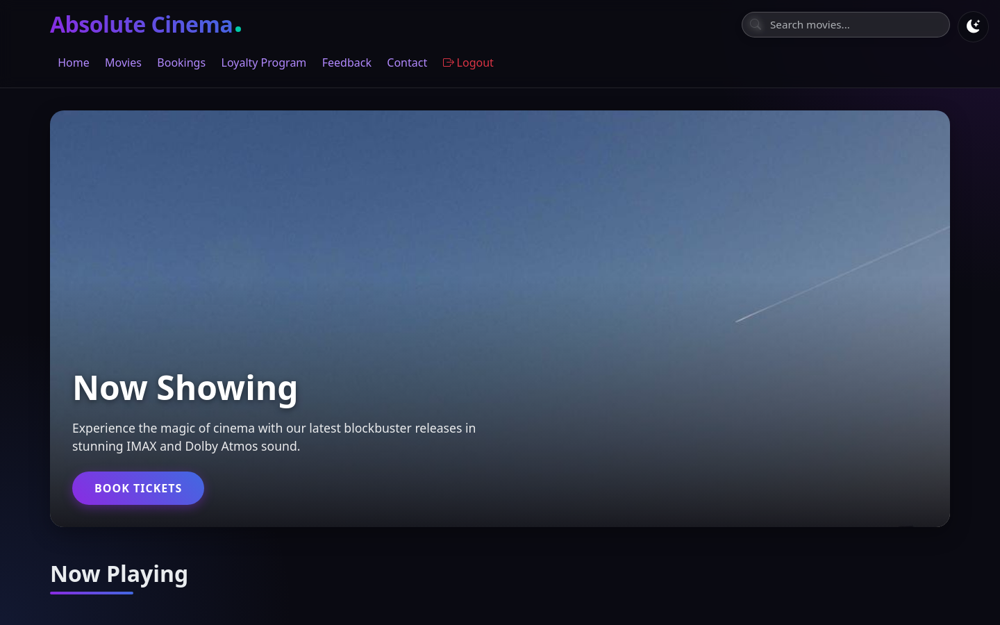

</div>

## Overview

Absolute Cinema is a Spring Boot web application that runs a movie theater end to end. Customers browse the catalog, pick a showtime and seats, add snacks, and pay with Stripe, earning loyalty points along the way. Staff see their shifts and salary, and administrators get dashboards for sales, popular movies, and customer feedback.

It was built by a team of six, using GitHub issues for planning and pull requests for review.

## Features

| Area | What it does |
| --- | --- |
| **Authentication & roles** | Spring Security form login with BCrypt password hashing. After login, users are routed to the customer, employee, or admin experience by account type. |
| **Booking flow** | Multi-step wizard: movie → showtime → interactive seat map → snacks → payment. |
| **Payments** | Stripe PaymentIntents, with the option to pay with loyalty points instead. |
| **Loyalty program** | Points earned per ticket and snack, Bronze/Silver/Gold tiers, and redemption at checkout. |
| **Booking history** | Customers can review past bookings with totals and session details. |
| **Feedback** | Customers rate and review movies. Admins see sentiment counts and a 30-day rating trend. |
| **Admin analytics** | Chart.js dashboards for tickets and snacks sold, revenue split, and most popular movies. |
| **Employee portal** | Monthly salary and recent shifts for each staff member. |
| **REST API** | JSON endpoints under `/api/{movies,sessions,snacks,users,loyalty,feedback}` drive the dynamic UI. |
| **Theming** | Light/dark theme toggle, remembered across visits. |

## Screenshots

| Sign in | Sign up |
| --- | --- |
| 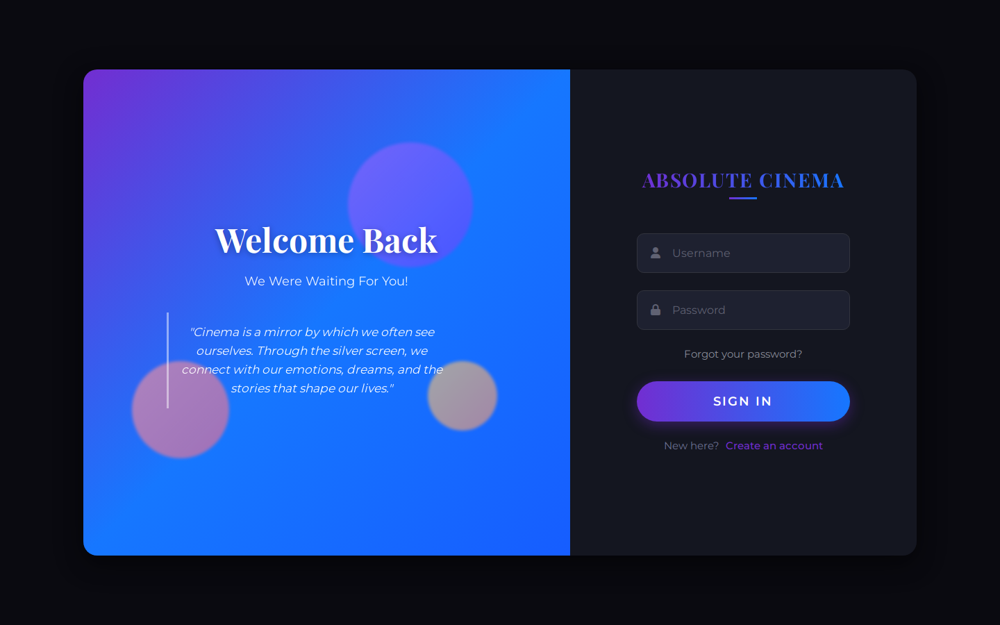 | 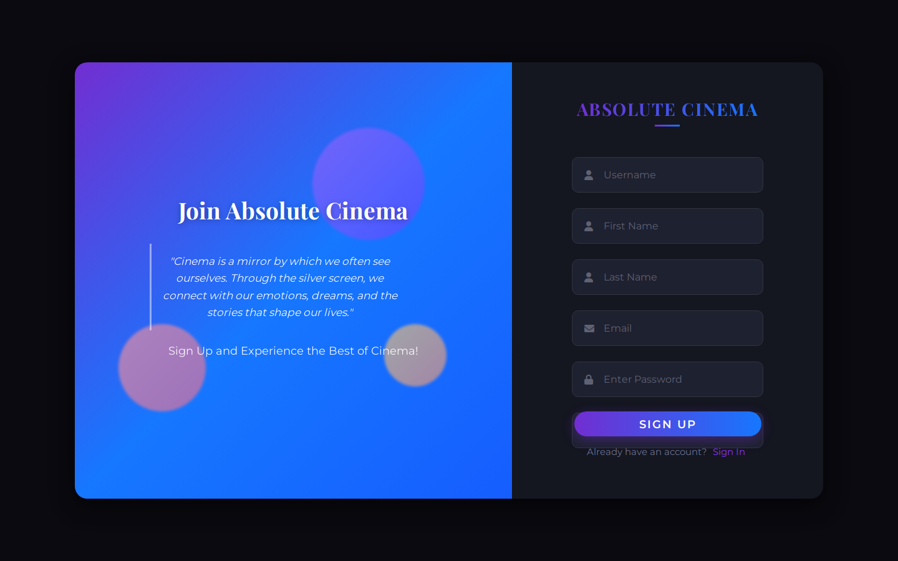 |
| **Seat selection** | **Snacks** |
| 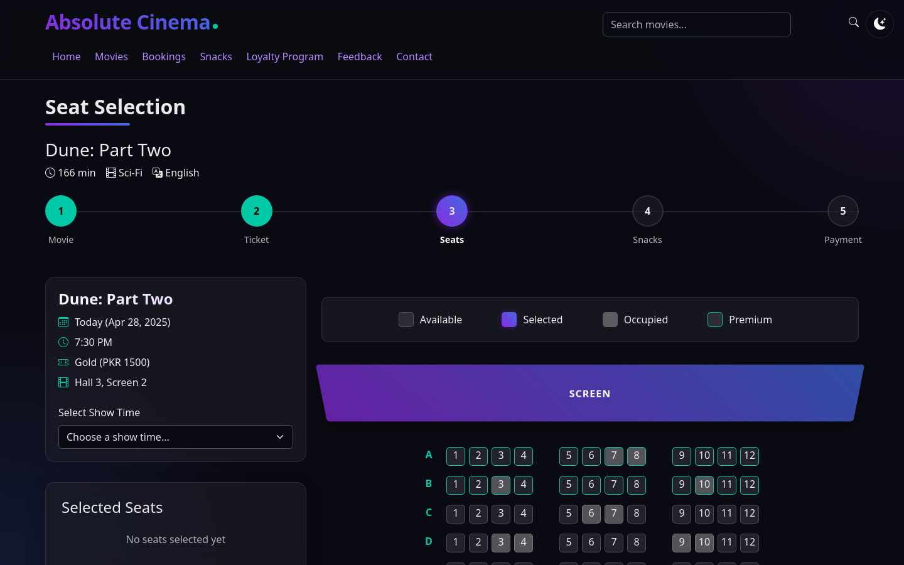 | 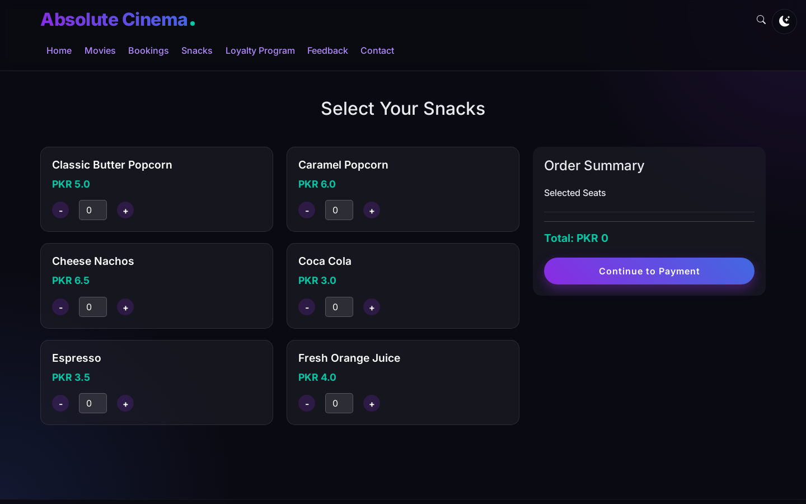 |
| **Loyalty program** | **Booking history** |
| 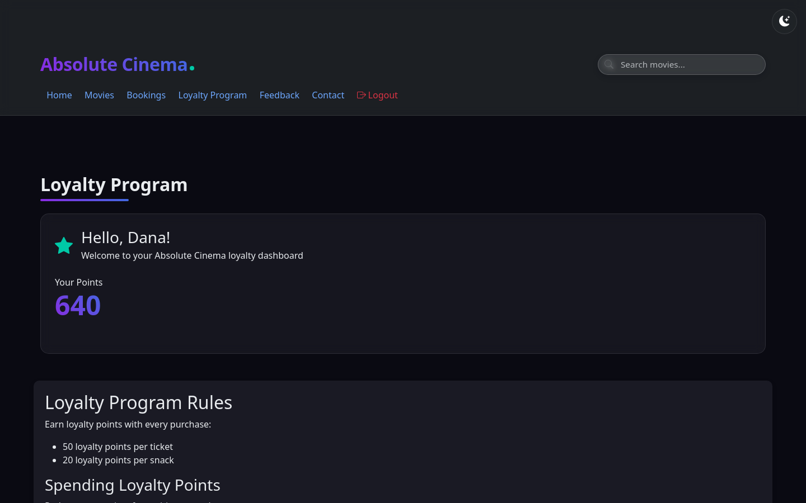 | 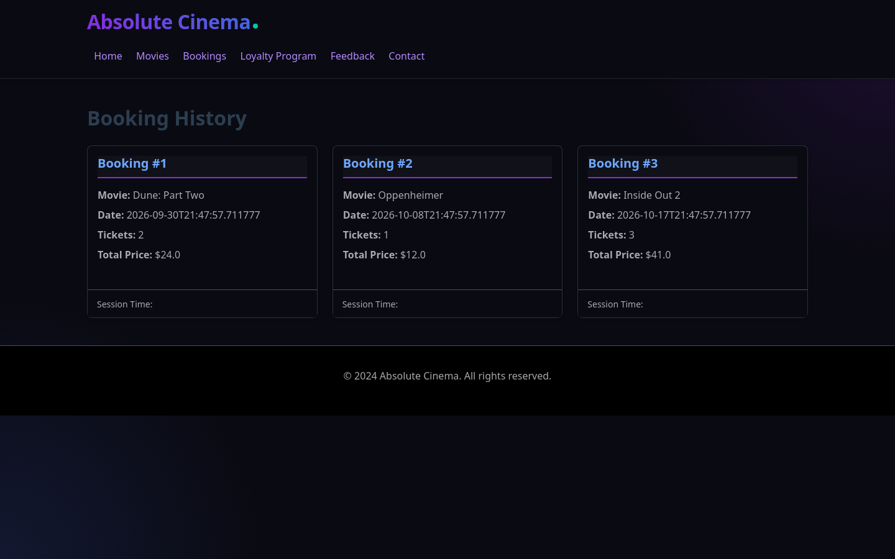 |
| **Admin dashboard** | **Admin analytics** |
| 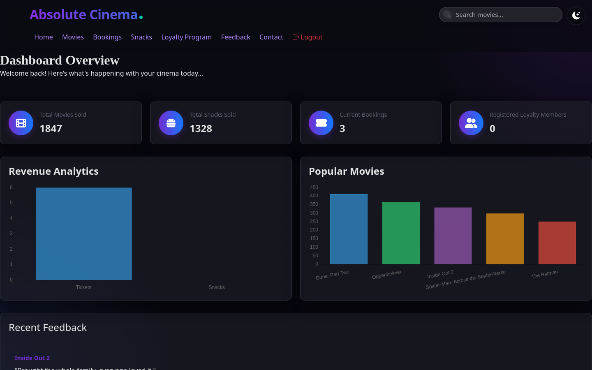 | 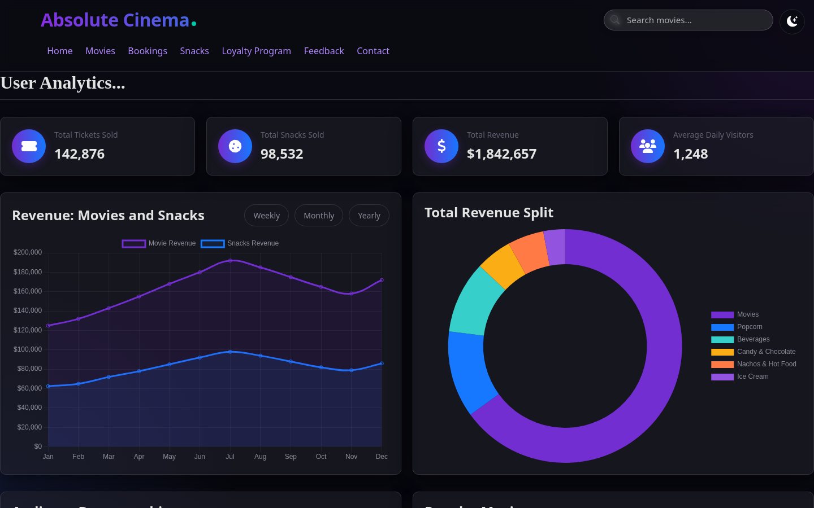 |
| **Feedback management** | **Employee dashboard** |
| 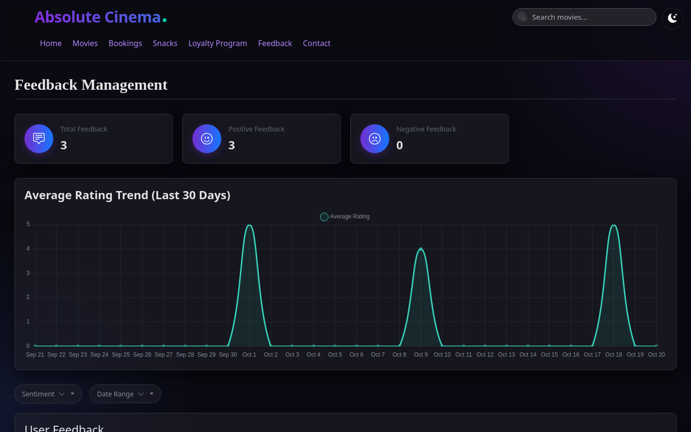 | 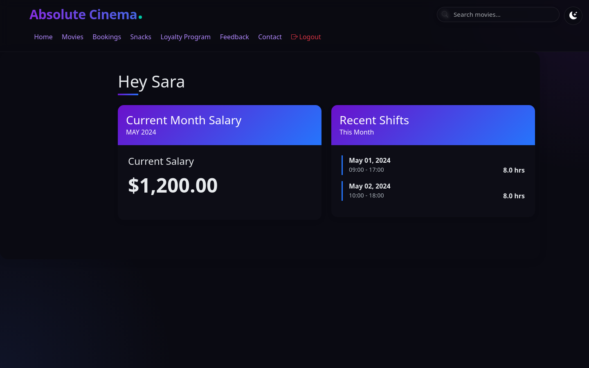 |

## Tech stack

- **Backend:** Java 17, Spring Boot 3.4 (Web MVC, Data JPA, Security), Hibernate
- **Database:** PostgreSQL
- **Views:** Pebble templates, Bootstrap 5, Chart.js, vanilla JavaScript
- **Payments:** Stripe Java SDK and Stripe.js
- **Build & tooling:** Gradle (Kotlin DSL), Docker, Docker Compose, GitHub Actions

## Architecture

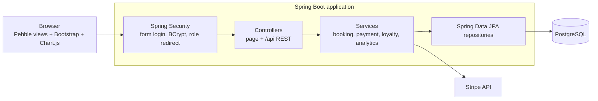

The code follows a standard layered layout:

```
src/main/java/com/absolutecinema/
├── config/        # Security, persistence, and MVC configuration
├── controller/    # Page controllers and /api REST controllers
├── service/       # Business logic (bookings, payments, loyalty, analytics, payroll)
├── repository/    # Spring Data JPA repositories
└── entity/        # JPA entities: Movie, Session, Booking, Snack, User, Employee, Shift, Salary...
src/main/resources/
├── templates/     # Pebble views per area (auth, user, admin, employee, movies...)
└── static/        # CSS and JavaScript
```

## Getting started

### Option 1: Docker (recommended)

Requires Docker only.

```bash
git clone https://github.com/AnnusShahzad/AbsoluteCinema.git
cd AbsoluteCinema
docker compose up --build
```

When the app has started, load the demo data (movies, showtimes, snacks, and demo accounts):

```bash
docker compose exec -T db psql -U cinema -d absolutecinema < scripts/demo-data.sql
```

Open <http://localhost:8080> and sign in with one of these accounts (password `demo1234` for all):

| Username | Role |
| --- | --- |
| `demo` | Customer |
| `employee` | Employee |
| `admin` | Administrator |

To try card payments, export your [Stripe test keys](https://dashboard.stripe.com/test/apikeys) as `STRIPE_PUBLIC_KEY` and `STRIPE_SECRET_KEY` before running `docker compose up`.

### Option 2: Run locally

Requires JDK 17+ and a PostgreSQL instance.

```bash
cp .env.example .env      # then edit the database URL, credentials, and Stripe keys
./gradlew bootRun
```

## Team

Built collaboratively by
[@AnnusShahzad](https://github.com/AnnusShahzad),
[@Moeez-Salman](https://github.com/Moeez-Salman),
[@isbaharif](https://github.com/isbaharif),
[@Ryyan-Choudhary](https://github.com/Ryyan-Choudhary),
[@razaalirizvi4](https://github.com/razaalirizvi4) and
[@MMustafa1](https://github.com/MMustafa1).

## License

Released under the [MIT License](LICENSE).
